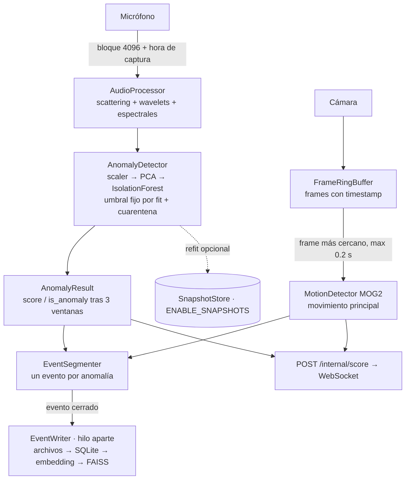

# Arquitectura vigente

Flujo de detección del proceso pipeline tras [ADR-0014](../adr/0014-nucleo-de-deteccion-funcional.md)
(núcleo corregido) y [ADR-0015](../adr/0015-destilacion-del-sistema.md) (módulos retirados).
La arquitectura multimodal de fusión tardía (v0.3) se describe en las ADR 0001–0007, hoy
reemplazadas.

## Flujo de detección (proceso pipeline)

## Notas

- **Ventanas:** 4096 muestras a 16 kHz (0.256 s), sin solapamiento; cada una lleva la hora de
  captura calculada en el callback de audio.
- **Detector:** buffer de 500 vectores crudos; cada fit (inicial y cada 200 ventanas nuevas)
  aprende la cadena completa y fija el umbral en el percentil 2 de los scores de
  entrenamiento. Las ventanas anómalas no entran al buffer salvo que persistan ~60 s.
- **Eventos:** se cierran tras 2 s sin anomalía o a los 60 s; guardan audio con pre-roll, el
  frame del pico, inicio, fin y duración.
- **Cámara:** contexto visual (frame, `motion_energy`, movimiento principal); no interviene en
  la decisión.
- **Opcionales:** drift C2ST y refits por drift (`ENABLE_DRIFT`), snapshots
  (`ENABLE_SNAPSHOTS`) — [ADR-0008](../adr/0008-drift-aware-adaptive-refit-policy.md),
  [ADR-0009](../adr/0009-model-snapshots-and-retention.md).
- **Verificación:** `scripts/replay.py` reproduce escenarios con verdad conocida y calcula una
  huella de las decisiones del detector.
